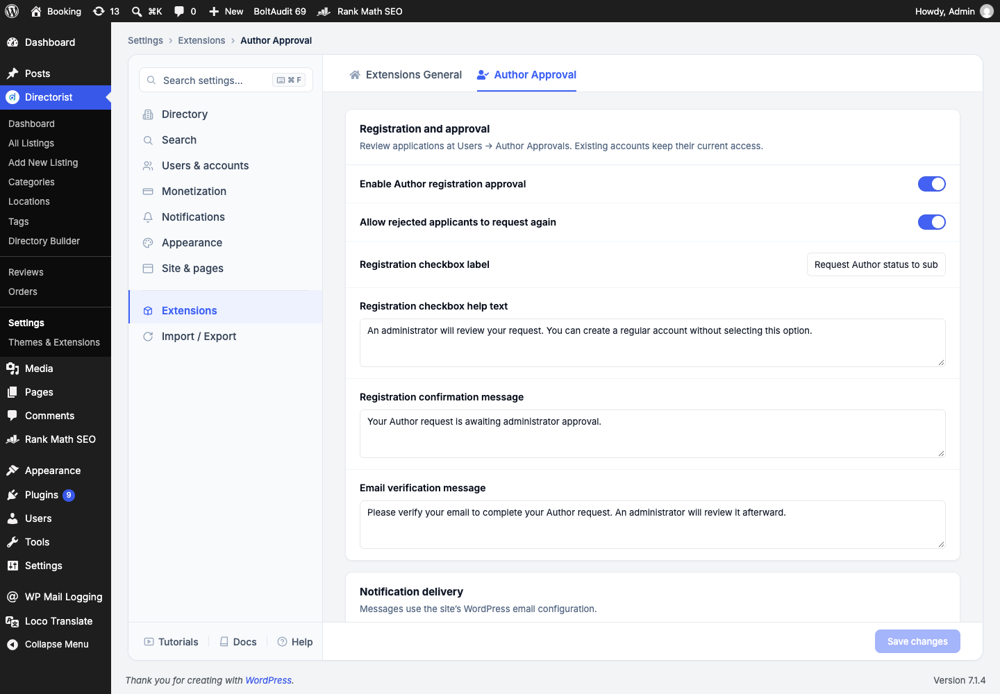
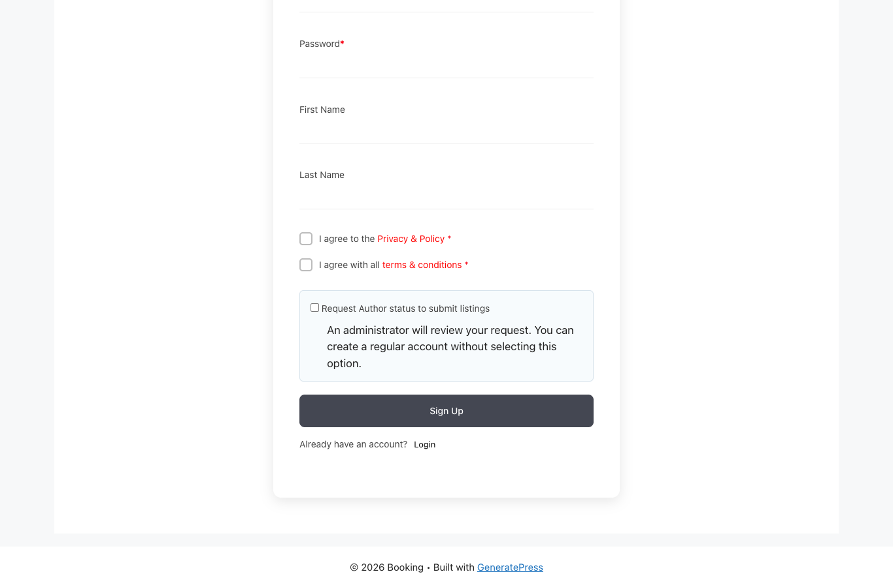
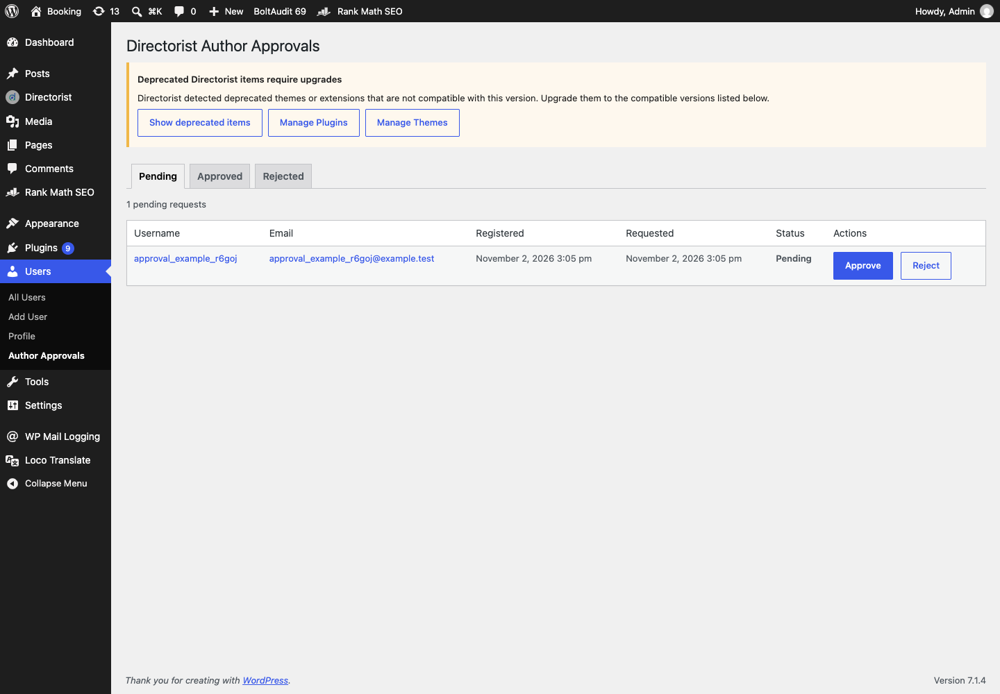
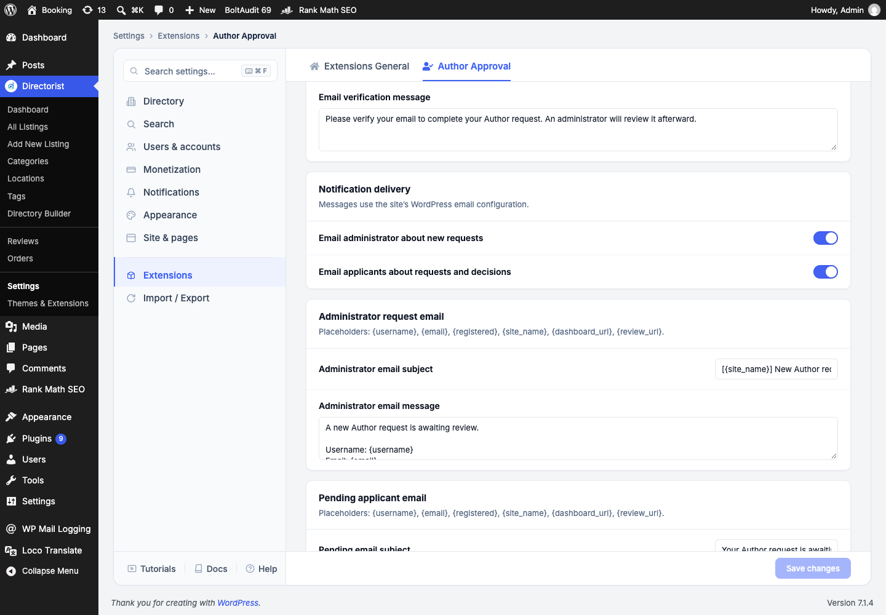

# Directorist Author Registration Approval: Documentation

This document covers setup, the approval lifecycle, every setting, and maintenance. For a quick start, use [README.md](README.md).

## Navigation

| Screen | Admin path | Purpose |
| --- | --- | --- |
| Extension settings | **Directorist → Settings → Extensions → Author Approval** | Change behavior, notifications, and text |
| Request queue | **Users → Author Approvals → Pending** | Approve or reject requests |
| Decision history | **Users → Author Approvals → Approved / Rejected** | Review prior decisions |
| User overview | **Users → All Users** | See the **Author Approval** status column |

The screenshots below were taken on the Booking Local site. A temporary example request was created only for the approval queue screenshot and then deleted. Site theme, Directorist version, and enabled extensions can change the appearance.

## Installation and first check

1. Install and activate Directorist.
2. Upload the extension ZIP in **Plugins → Add Plugin → Upload Plugin**, install, and activate it.
3. Go to **Directorist → Settings → Extensions → Author Approval**. Make sure **Enable Author registration approval** is on and select **Save changes** if you changed anything.
4. Open the Directorist registration page in a signed-out browser window. Confirm the request checkbox appears.
5. Review **Users → Author Approvals** for requests.

WordPress 6.5+, PHP 7.4+, and Directorist are required. The extension was tested with Directorist 8.10.7. If Directorist is inactive, this plugin displays an admin warning and does not load its workflow hooks.



## Applicant lifecycle

```text
Directorist registration
  ├─ Checkbox clear → Regular account
  └─ Request Author status → Pending request
                              ├─ Approve → Directorist Author
                              └─ Reject → Regular account
                                            └─ Request again, if enabled → Pending
```

The checkbox is shown on Directorist registration forms. Selecting Directorist's native Author choice also creates a pending request. An existing regular user can request access through Directorist's **Become an Author** dashboard action. Neither path grants Author access before approval.



If Directorist email verification is enabled, account creation and the approval request complete after the applicant verifies the address. A verification message can be customized in Extensions settings. The Pending queue remains empty for an applicant who has not completed verification.

Managed regular, pending, and rejected users cannot use Directorist listing capabilities or write listings through the front-end form, REST listing routes, or direct WordPress post insertion. Approved users receive Directorist's Author user type. Directorist's own rules for pricing plans, required fields, and moderation continue to apply. No listing is published as part of approval.

Existing accounts that predate the extension and have no approval status retain their existing access. New subscribers created through other WordPress registration paths are marked Regular so they cannot bypass approval by avoiding the Directorist form.

## Administrator review

Open **Users → Author Approvals**. The Pending tab shows username, email, registration date, request date, status, and **Approve** / **Reject** buttons. Each action affects one account and requires an authorized administrator. The Approved and Rejected tabs retain decision history. The Users list also shows the current status for managed accounts.



Only users with WordPress `manage_options` can review requests. An applicant cannot approve their own request. Requests can be reviewed only while their status is Pending. The extension records the request time, decision time, and administrator ID in user metadata.

## Settings reference

Open **Directorist → Settings → Extensions → Author Approval** and choose **Save changes** after editing. The controls are divided into these sections:

### Registration and approval

| Setting | Purpose | Default |
| --- | --- | --- |
| Enable Author registration approval | Shows the request option and enforces approval restrictions | On |
| Allow rejected applicants to request again | Shows a request again button to rejected applicants | Off |
| Registration checkbox label | Text beside the request checkbox | “Request Author status to submit listings” |
| Registration checkbox help text | Explanation below the checkbox | Explains administrator review and regular signup |
| Registration confirmation message | Message after a successful request | Awaiting administrator approval |
| Email verification message | Message shown while email verification is needed | Verify email before review |

### Notification delivery

| Setting | Purpose | Default |
| --- | --- | --- |
| Email administrator about new requests | Email the site's WordPress Administration Email Address | On |
| Email applicants about requests and decisions | Send pending, approved, and rejected emails | On |

The admin switch controls only the new request email. The applicant switch controls all three applicant status emails. Email delivery relies on WordPress `wp_mail()` and the site's mail transport.



### Email templates

| Section | Editable fields | Sent when |
| --- | --- | --- |
| Administrator request email | Subject and message | A new request is created |
| Pending applicant email | Subject and message | A request is created |
| Approved applicant email | Subject and message | An administrator approves |
| Rejected applicant email | Subject and message | An administrator rejects |

The following placeholders are replaced in subjects and messages:

| Placeholder | Replacement |
| --- | --- |
| `{username}` | Applicant's WordPress login name |
| `{email}` | Applicant's email address |
| `{registered}` | Account registration date and time in the site's format |
| `{site_name}` | WordPress site title |
| `{dashboard_url}` | Directorist user dashboard URL |
| `{review_url}` | Administrator approval queue URL |

Example subject: `[{site_name}] New Author request`. Example body:

```text
Username: {username}
Email: {email}
Review: {review_url}
```

Enter actual line breaks in message fields; email is sent as plain text. The review URL is intended for administrators, so include it primarily in the administrator template.

### Dashboard status messages

| Setting | Shown to |
| --- | --- |
| Pending dashboard message | An applicant awaiting review |
| Approved dashboard message | An approved Author |
| Rejected dashboard message | A rejected applicant |
| Request again button label | A rejected applicant, only when reapplication is enabled |

## Changing or disabling the workflow

Changing a message or email template affects future page loads or emails; it does not resend old notifications. Changing **Allow rejected applicants to request again** affects the availability of the dashboard action immediately after the setting is saved.

Turning off **Enable Author registration approval** hides the registration request option and stops this extension's listing restrictions. It does not delete statuses or reverse Directorist user types. Turning it back on resumes enforcement using the saved statuses. Deactivating or deleting the plugin also leaves user metadata and Directorist data in place. Existing settings from the earlier separate settings screen are migrated to Directorist's Extensions settings when this version loads.

## Troubleshooting

| Symptom | Check |
| --- | --- |
| Request checkbox is not visible | Both plugins are active, Directorist registration is enabled, the approval switch is on, and you are signed out |
| Registration succeeded but no Pending entry appears | Confirm the checkbox was selected and any required email verification is complete |
| Approved user still cannot submit | Confirm Approved status; then check Directorist's listing permissions, pricing plan, payment, and required fields |
| Rejected user has no request again button | Enable reapplication and reload their Directorist dashboard |
| Notification email is missing | Check notification switches, the WordPress administration email, site mail transport, spam folder, and any mail log |
| Directorist is inactive | Reactivate Directorist; this extension requires it |

The extension's email dispatch was tested by intercepting WordPress `wp_mail()` calls. Successful delivery to an external inbox depends on the site's mail configuration.

## Data and security notes

The extension stores its options within Directorist's `atbdp_option` WordPress option, using `daa_` prefixes. Current account status uses `_daa_author_status` user metadata. Request and decision timestamps and reviewer ID are also stored as user metadata. These keys remain after deactivation so the workflow can resume later.

Administrator decisions require `manage_options` and a WordPress nonce. The extension blocks managed unapproved users at Directorist capability checks, front-end submission, REST submission, and post-write boundaries. It does not change Directorist core files or automatically publish listings.
