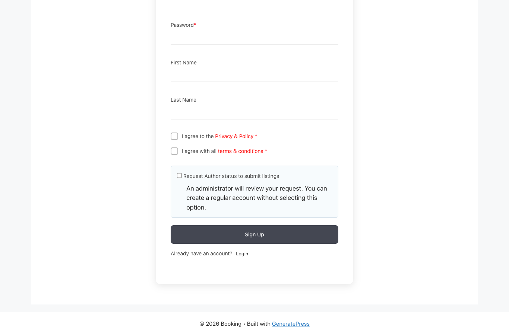
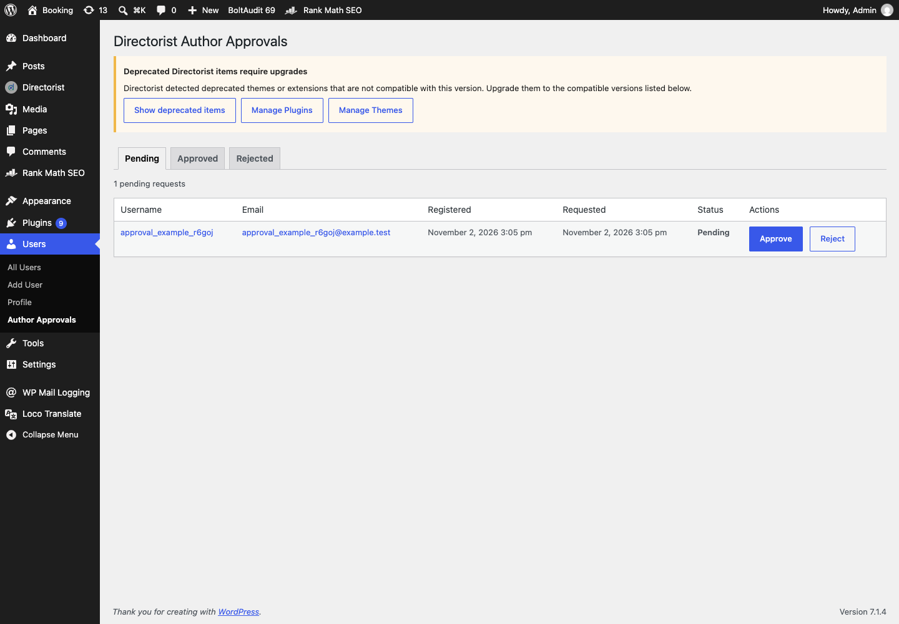
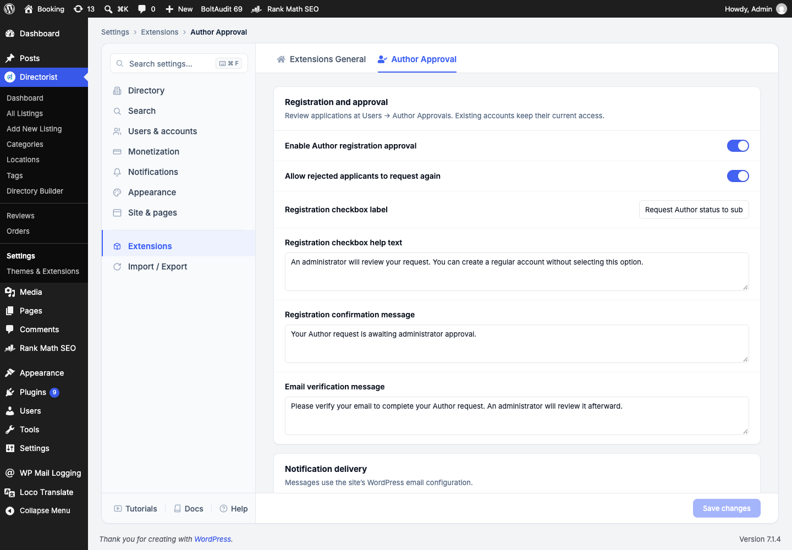
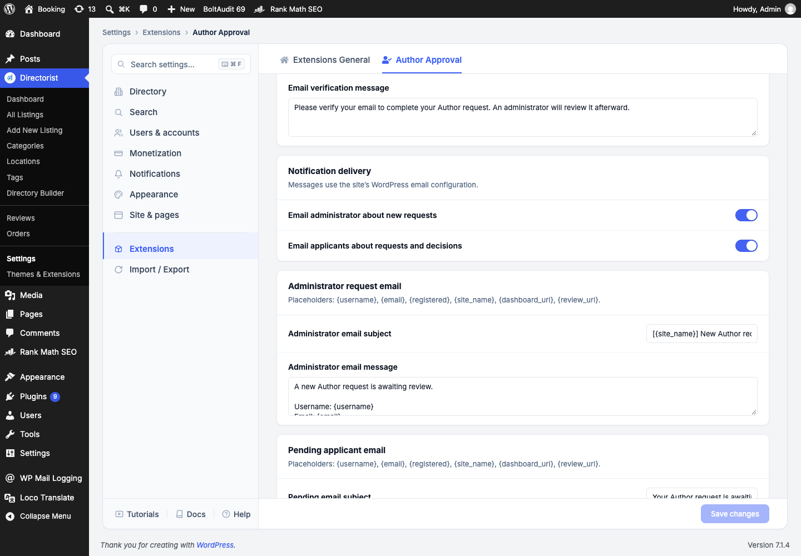

# Directorist Author Registration Approval

Let people request Directorist Author status while an administrator decides who can submit listings. This is a separate WordPress plugin; it does not modify Directorist.

## At a glance

| Task | Where to go |
| --- | --- |
| Configure approval, messages, and emails | **Directorist → Settings → Extensions → Author Approval** |
| Approve or reject requests | **Users → Author Approvals** |
| See an account's current status | **Users → All Users**, in the **Author Approval** column |
| Request Author status | The Directorist registration form, or the Directorist dashboard's **Become an Author** action |

## Requirements and installation

- WordPress 6.5 or newer and PHP 7.4 or newer.
- An active Directorist installation. This release was tested with Directorist 8.10.7.

1. In WordPress admin, open **Plugins → Add Plugin → Upload Plugin**.
2. Select the `directorist-author-approval` ZIP file and choose **Install Now**.
3. Activate **Directorist Author Registration Approval**. Activate Directorist first if needed.
4. Open **Directorist → Settings → Extensions → Author Approval**, review the options, and choose **Save changes**.

The plugin is already installed and active on this Local site. If you are using the source directory instead of the ZIP, keep the entire `directorist-author-approval` folder inside `wp-content/plugins/`.

## How an applicant requests access

On the Directorist registration form, select **Request Author status to submit listings** before signing up. Leaving the box clear creates a regular account. A request remains pending until an administrator reviews it. If Directorist requires email verification, the applicant must verify the address before the account and approval request are completed.

An existing regular user can use Directorist's **Become an Author** action on their dashboard. The request is sent for review; it does not grant Author access immediately.

## How an administrator reviews requests

1. Open **Users → Author Approvals → Pending**.
2. Review the username, email, registration date, and request date.
3. Choose **Approve** or **Reject** for that person.
4. Use the **Approved** and **Rejected** tabs to view past decisions.

Approving a request gives the user Directorist Author status. They can then submit listings, subject to Directorist's other requirements and listing moderation settings. Approval does not publish any listing. Rejection keeps the account regular. If **Allow rejected applicants to request again** is enabled, a rejected applicant sees a new request button on their Directorist dashboard.

The approval screenshot uses a temporary example account that was removed after capture.

## Configure the extension

Open **Directorist → Settings → Extensions → Author Approval**. The page contains registration and approval controls, notification switches, email templates, and dashboard messages. Save changes at the bottom of the Directorist settings page.

The main switches are:

| Setting | Effect | Default |
| --- | --- | --- |
| Enable Author registration approval | Shows the request option and enforces approval for managed accounts | On |
| Allow rejected applicants to request again | Adds a new request action to a rejected applicant's dashboard | Off |
| Email administrator about new requests | Sends a request email to the WordPress **Administration Email Address** | On |
| Email applicants about requests and decisions | Sends pending, approved, and rejected emails | On |

You can also edit the registration checkbox label and help text, confirmation and verification messages, all email subjects and bodies, the three dashboard status messages, and the request again button label. Email delivery uses the site's `wp_mail()` configuration. The switches shown in screenshots reflect this Local site's settings and may differ from the defaults.

Email templates support `{username}`, `{email}`, `{registered}`, `{site_name}`, `{dashboard_url}`, and `{review_url}`. For example, `Hello {username}, review your account at {dashboard_url}` substitutes the applicant's details when sent. Messages are plain text.

## Status and access

| Status | What it means | Listing access |
| --- | --- | --- |
| Regular | The new user did not request Author status | Blocked by this extension |
| Pending | Waiting for administrator review | Blocked |
| Approved | The administrator accepted the request | Directorist Author access |
| Rejected | The administrator declined the request | Blocked |

Existing accounts without an approval status are left as they were, including existing Authors. New WordPress subscribers are tracked as regular accounts. Disabling the approval switch or deactivating this plugin stops its restrictions but keeps approval history. Re-enabling it restores restrictions based on each managed account's saved status.

## If something does not work

- **The request option is missing:** Check that Directorist and this plugin are active, Directorist registration is enabled, and **Enable Author registration approval** is on. Open a Directorist registration form while signed out.
- **A request is not in Pending:** If email verification is enabled, confirm the applicant verified their address. Also confirm they selected the request checkbox.
- **An applicant cannot submit after approval:** Check the **Approved** tab and Directorist's own listing, pricing, and moderation requirements.
- **Emails are missing:** Confirm the notification switches, WordPress administration email address, and the site's mail delivery configuration. Look in the spam folder or a mail log if available.
- **A rejected applicant cannot request again:** Turn on **Allow rejected applicants to request again** in Extensions settings.

For a complete settings reference, lifecycle notes, maintenance guidance, and technical details, see [DOCUMENTATION.md](DOCUMENTATION.md).
